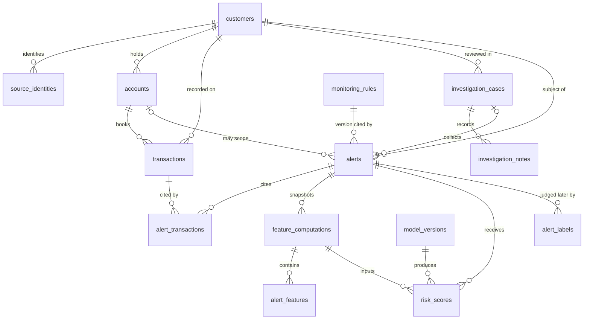

# Database design

## Purpose

This document describes the PostgreSQL schema in `db/migrations/0001_initial_schema.sql`. The baseline server is PostgreSQL 15 or newer. The migration creates empty structures. It does not load parties, payments, rules, models, scores, or labels.

The schema is the system of record for alert optimization and model governance. Two schemas separate operations from evaluation labels:

| Schema | Contents |
| --- | --- |
| `amlog` | Customers, accounts, transactions, rules, alerts, features, models, scores, cases, notes, and audit events. |
| `amlog_label` | Ground-truth and evaluation labels. Scoring must not receive access to this schema. |

`PUBLIC` has no privileges on either schema. The user that applies the migration still owns it. Application roles are a later deployment decision and are not created here.

## Conventions

- Primary keys are UUIDs. The database can generate them with `gen_random_uuid()`, which is built into PostgreSQL 15 and does not require an extension.
- Business references such as `customer_reference` and `alert_reference` are separate unique text keys. Their length is not capped, because a source identifier must not be truncated to satisfy an arbitrary column width.
- Money uses `NUMERIC(38, 8)`: 30 digits before the decimal point and 8 after. That is a precision choice for one amount, not a limit on how many transactions can be stored. The PostgreSQL `MONEY` type is not used, because it depends on the server locale. Floating-point types are not used.
- Feature values that are numeric use unconstrained `NUMERIC`, so a ratio or a count is not forced into the monetary scale.
- Exchange rates use `NUMERIC(38, 18)`.
- Scores use unconstrained `NUMERIC`. The meaning of the number is stored in `score_semantics`. A 0-to-1 range is not enforced, because no algorithm is selected.
- Every instant uses `TIMESTAMPTZ`.
- Allowed lifecycle values use `TEXT` plus a check constraint, not a PostgreSQL enum. Adding a value is a new migration.
- Foreign keys use `ON DELETE RESTRICT`. History is not removed by a cascading delete.
- Country codes are two uppercase letters and currency codes are three uppercase letters. The shape is checked. A reference list of real ISO codes is not installed yet.
- Channel names and transaction types are required text. The schema does not list the permitted channels.

## Entity relationship diagram

A transaction may also point at one earlier transaction through `corrects_transaction_id`. That self-link is omitted from the drawing so the correction cardinality is not misread. Corrections are new rows.

## Relationships

| From | To | Cardinality | Rule |
| --- | --- | --- | --- |
| `customers` | `source_identities` | one to many | Each identity belongs to one customer. |
| `customers` | `accounts` | one to many | Each account has one current customer. That link cannot be updated. |
| `customers` | `transactions` | one to many | The transaction customer must currently own the account. |
| `accounts` | `transactions` | one to many | Every transaction is booked to one account. |
| `transactions` | `transactions` | zero or one earlier row | A correction cites another transaction and cannot cite itself. |
| `customers` | `investigation_cases` | one to many | A case concerns one customer. |
| `investigation_cases` | `investigation_notes` | one to many | Notes are append-only. |
| `monitoring_rules` | `alerts` | one to many | The alert cites one version row, and that version must be active at insert. |
| `customers` | `alerts` | one to many | The alert subject is required. |
| `accounts` | `alerts` | zero or one account | Optional. When present, the account must belong to the alert customer. |
| `investigation_cases` | `alerts` | zero or one case | Optional. The case customer and the alert customer must match. |
| `alerts` | `transactions` | many to many | Through `alert_transactions`. A link is not updated or deleted. |
| `alerts` | `feature_computations` | one to many | Each snapshot belongs to one alert. |
| `feature_computations` | `alert_features` | one to many | One row per feature value. The feature row must cite the same alert as the snapshot. |
| `feature_computations` | `risk_scores` | one to many | A score must copy that snapshot's feature-set identity and fingerprint. That identity must be the exact feature set required by the cited model version. |
| `model_versions` | `risk_scores` | one to many | A score must copy the model name, version label, and algorithm family. |
| `alerts` | `alert_labels` | one to many | The label schema references alerts. Scores do not reference labels. |

There is no foreign key from `risk_scores` to `alert_labels` or to `investigation_cases.disposition`.

## Supporting tables

The requested operational entities are all present. Four additional tables carry rules that would otherwise be comments:

| Table | Why it exists |
| --- | --- |
| `feature_computations` | Groups the feature rows that were available when a score was produced, and holds their shared fingerprint. |
| `investigation_notes` | Keeps investigator text append-only. The case row stores only a short current summary. |
| `alert_labels` | Keeps evaluation labels outside the operational schema. |
| `schema_migrations` | Records which SQL version was applied, and the checksum of that file. |

## schema_migrations

Bookkeeping for the migration runner. Rows are inserted only by the runner. Updates, deletes, and truncates are rejected.

| Column | Type | Required | Constraint |
| --- | --- | --- | --- |
| `version` | `TEXT` | yes | Primary key. Four digits. |
| `name` | `TEXT` | yes | Lowercase migration name. |
| `checksum` | `TEXT` | yes | 64-character SHA-256 of the file bytes. |
| `applied_at` | `TIMESTAMPTZ` | yes | Time the runner recorded the version. |

## customers

The monitoring subject. The legal name and residency country are stored so a person can recognize the party. Government identifiers, birth dates, addresses, and contact details are omitted on purpose.

| Column | Type | Required | Constraint |
| --- | --- | --- | --- |
| `customer_id` | `UUID` | yes | Primary key. Immutable. |
| `customer_reference` | `TEXT` | yes | Unique business key. Immutable. |
| `customer_type` | `TEXT` | yes | `individual`, `organization`, or `other`. |
| `legal_name` | `TEXT` | yes | Non-blank. |
| `residency_country_code` | `CHAR(2)` | no | Two uppercase letters when present. |
| `lifecycle_status` | `TEXT` | yes | `prospect`, `active`, `restricted`, or `closed`. |
| `onboarded_at` | `TIMESTAMPTZ` | no | When the source says the party was onboarded. |
| `created_at` | `TIMESTAMPTZ` | yes | Immutable. |
| `updated_at` | `TIMESTAMPTZ` | yes | Maintained on update. |

Deletes are rejected. Close the party by status instead.

## source_identities

An identifier for a customer in an upstream system, such as a core-system customer number. The column does not restrict the kind of identifier.

| Column | Type | Required | Constraint |
| --- | --- | --- | --- |
| `source_identity_id` | `UUID` | yes | Primary key. Immutable. |
| `customer_id` | `UUID` | yes | Foreign key to `customers`. Immutable. |
| `source_system` | `TEXT` | yes | Part of the identity key. Immutable. |
| `identity_type` | `TEXT` | yes | Part of the identity key. Immutable. |
| `identity_value` | `TEXT` | yes | Part of the identity key. Immutable. |
| `valid_from` | `TIMESTAMPTZ` | yes | Start of validity. |
| `valid_to` | `TIMESTAMPTZ` | no | Must be later than `valid_from` when set. |
| `created_at` | `TIMESTAMPTZ` | yes | Immutable. |
| `updated_at` | `TIMESTAMPTZ` | yes | Maintained on update. |

A partial unique index allows only one open row (`valid_to` is null) for a source, type, and value. Overlapping historical periods are not fully excluded. That would need an exclusion constraint and is a review item.

To change an identifier, set `valid_to` and insert a new row. The old key values cannot be edited, and the row cannot be deleted.

## accounts

An account held by one current customer.

| Column | Type | Required | Constraint |
| --- | --- | --- | --- |
| `account_id` | `UUID` | yes | Primary key. Immutable. |
| `customer_id` | `UUID` | yes | Foreign key to `customers`. Immutable. |
| `account_reference` | `TEXT` | yes | Unique. Immutable. |
| `source_system` | `TEXT` | yes | With `source_account_id`, unique and immutable. |
| `source_account_id` | `TEXT` | yes | Source account identifier. Immutable. |
| `account_type` | `TEXT` | yes | Non-blank. Not a fixed catalog. |
| `currency_code` | `CHAR(3)` | yes | Three uppercase letters. Immutable. |
| `lifecycle_status` | `TEXT` | yes | `pending`, `open`, `restricted`, or `closed`. |
| `opened_at` | `TIMESTAMPTZ` | no | Optional source opening time. |
| `closed_at` | `TIMESTAMPTZ` | no | Not earlier than `opened_at` when both exist. |
| `created_at` | `TIMESTAMPTZ` | yes | Immutable. |
| `updated_at` | `TIMESTAMPTZ` | yes | Maintained on update. |

Joint accounts and ownership moving from one customer to another are not modeled. Because the customer link cannot change, a mistaken owner cannot be corrected in place. The account would be closed and a new account row opened. This is a deliberate limitation until an ownership-history table is reviewed.

## transactions

An immutable financial event as received from a source.

| Column | Type | Required | Constraint |
| --- | --- | --- | --- |
| `transaction_id` | `UUID` | yes | Primary key. |
| `source_system` | `TEXT` | yes | With `source_event_id`, unique. |
| `source_event_id` | `TEXT` | yes | Duplicate-event key. Non-blank. |
| `account_id` | `UUID` | yes | Foreign key to `accounts`. |
| `customer_id` | `UUID` | yes | Foreign key to `customers`. Must own the account. |
| `counterparty_reference` | `TEXT` | no | Reference as received. Not a mastered party. |
| `counterparty_name` | `TEXT` | no | Name as received. |
| `counterparty_country_code` | `CHAR(2)` | no | Two uppercase letters when present. |
| `counterparty_institution_reference` | `TEXT` | no | Institution reference as received. |
| `payment_channel` | `TEXT` | yes | Required channel name. No channel catalog. |
| `transaction_type` | `TEXT` | yes | Required type name. No type catalog. |
| `direction` | `TEXT` | yes | `debit` or `credit`. |
| `amount` | `NUMERIC(38, 8)` | yes | Exact and non-negative. |
| `currency_code` | `CHAR(3)` | yes | Currency of `amount`. Not required to equal the account currency. |
| `base_currency_code` | `CHAR(3)` | no | Present only together with `base_amount`. |
| `base_amount` | `NUMERIC(38, 8)` | no | Source-supplied converted amount. This platform does not calculate it. |
| `fx_rate` | `NUMERIC(38, 18)` | no | Exact rate. Allowed only when the base pair is present, and must be positive. |
| `event_timestamp` | `TIMESTAMPTZ` | yes | When the activity happened. |
| `booked_at` | `TIMESTAMPTZ` | no | When the source booked it. |
| `ingested_at` | `TIMESTAMPTZ` | yes | When this platform stored it. |
| `corrects_transaction_id` | `UUID` | no | Earlier transaction. Cannot equal `transaction_id`. |
| `correlation_id` | `UUID` | no | Ties the row to a processing flow. |
| `created_at` | `TIMESTAMPTZ` | yes | Insert time. |

Updates, deletes, and truncates are rejected. A zero amount is allowed. A negative amount is not. Direction carries the sign.

Indexes: account plus event time, customer plus event time, channel plus event time, type plus event time, a partial counterparty index, a BRIN index on `event_timestamp`, and `ingested_at`.

## monitoring_rules

One row is one version of a rule. This migration does not insert a rule. R001 version 1 and R002 version 1 are registered later by the monitoring replay, and only in a disposable database. `parameter_document` holds that version's threshold. An empty JSON object is not a rule. The application reads the document. The database does not interpret it.

| Column | Type | Required | Constraint |
| --- | --- | --- | --- |
| `monitoring_rule_id` | `UUID` | yes | Primary key. Immutable. |
| `rule_code` | `TEXT` | yes | Stable business code. Unique with `version_number`. Immutable. |
| `version_number` | `INTEGER` | yes | Starts at 1. Immutable. |
| `rule_name` | `TEXT` | yes | Editable only while the version is `draft`. |
| `description` | `TEXT` | no | Editable only while `draft`. |
| `parameter_document` | `JSONB` | yes | JSON object. Editable only while `draft`. |
| `severity` | `TEXT` | yes | `low`, `medium`, `high`, or `critical`. Editable only while `draft`. |
| `lifecycle_status` | `TEXT` | yes | `draft`, `active`, or `retired`. |
| `effective_from` | `TIMESTAMPTZ` | conditional | Required once the version is no longer `draft`. |
| `effective_to` | `TIMESTAMPTZ` | no | May be set when an active version is retired. Not rewritten after that. |
| `authored_by` | `TEXT` | yes | Immutable. |
| `created_at` | `TIMESTAMPTZ` | yes | Immutable. |

A draft may become active or retired. An active version may only stay active or become retired, and its definition cannot change. A retired version cannot change. Rows cannot be deleted. Alerts can cite only an active version, and the alert's recorded code and version must match the row.

## investigation_cases

The human investigation file. `disposition` is the operational outcome when the case is closed. It is not a training label.

| Column | Type | Required | Constraint |
| --- | --- | --- | --- |
| `investigation_case_id` | `UUID` | yes | Primary key. Immutable. |
| `case_reference` | `TEXT` | yes | Unique. Immutable. |
| `customer_id` | `UUID` | yes | Foreign key to `customers`. Immutable. |
| `lifecycle_status` | `TEXT` | yes | `open`, `in_progress`, `pending_information`, or `closed`. |
| `priority` | `TEXT` | yes | `routine`, `elevated`, or `urgent`. |
| `disposition` | `TEXT` | conditional | Required when closed. Null otherwise. |
| `assigned_to` | `TEXT` | no | Actor reference. There is no user-account table yet. |
| `status_summary` | `TEXT` | no | Current short summary only. Evidence belongs in notes. |
| `opened_at` | `TIMESTAMPTZ` | yes | Immutable. |
| `closed_at` | `TIMESTAMPTZ` | conditional | Required when closed, and not earlier than `opened_at`. |
| `created_at` | `TIMESTAMPTZ` | yes | Immutable. |
| `updated_at` | `TIMESTAMPTZ` | yes | Maintained on update. |

Disposition values are `no_further_action`, `continue_monitoring`, `escalated`, and `inconclusive`. The case cannot be deleted.

A mutable summary can be overwritten. Prior summary wording is preserved only if the writer also inserts an audit event. The database does not yet create that audit row automatically. Detailed investigator text belongs in `investigation_notes`.

The local review application is a writer of these rows. It opens one case for an alert, appends notes, and writes an audit row when the summary or disposition changes. It does not treat the disposition as a training label.

## investigation_notes

Append-only notes. A correction is a new note.

| Column | Type | Required | Constraint |
| --- | --- | --- | --- |
| `investigation_note_id` | `UUID` | yes | Primary key. |
| `investigation_case_id` | `UUID` | yes | Foreign key to `investigation_cases`. |
| `author_reference` | `TEXT` | yes | Non-blank actor reference. |
| `note_text` | `TEXT` | yes | Non-blank. |
| `noted_at` | `TIMESTAMPTZ` | yes | When the investigator wrote it. |
| `created_at` | `TIMESTAMPTZ` | yes | When the row was stored. |

## alerts

A monitoring result. Several fields are a generation snapshot and cannot be updated: the rule citation, the recorded rule code and version, the customer, the account, the trigger time, the window, and the summary.

| Column | Type | Required | Constraint |
| --- | --- | --- | --- |
| `alert_id` | `UUID` | yes | Primary key. Immutable. |
| `alert_reference` | `TEXT` | yes | Unique. Immutable. |
| `monitoring_rule_id` | `UUID` | yes | Foreign key to an active `monitoring_rules` row at insert. Immutable. |
| `recorded_rule_code` | `TEXT` | yes | Must match the cited rule. Immutable. |
| `recorded_rule_version` | `INTEGER` | yes | Must match the cited rule. Immutable. |
| `customer_id` | `UUID` | yes | Foreign key to `customers`. Immutable. |
| `account_id` | `UUID` | no | Foreign key to `accounts`. Immutable. Must belong to the customer. |
| `investigation_case_id` | `UUID` | no | Foreign key to `investigation_cases`. Customer must match. |
| `triggered_at` | `TIMESTAMPTZ` | yes | Immutable. |
| `window_started_at` | `TIMESTAMPTZ` | no | Immutable generation window. |
| `window_ended_at` | `TIMESTAMPTZ` | no | Not earlier than the start when both exist. Immutable. |
| `severity` | `TEXT` | yes | `low`, `medium`, `high`, or `critical`. May be adjusted operationally. |
| `lifecycle_status` | `TEXT` | yes | `open`, `queued`, `in_review`, `closed`, or `suppressed`. |
| `summary` | `TEXT` | no | System summary captured at generation. Immutable. |
| `created_at` | `TIMESTAMPTZ` | yes | Immutable. |
| `updated_at` | `TIMESTAMPTZ` | yes | Maintained on update. |

The alert cannot be deleted. Linking it to a case does not rewrite the generation snapshot. After the cited rule is retired, the alert remains valid because the active-rule check runs at insert only.

## alert_transactions

The transactions an alert cites. The pair of identifiers is the primary key, so the same transaction is cited once per alert.

| Column | Type | Required | Constraint |
| --- | --- | --- | --- |
| `alert_id` | `UUID` | yes | Foreign key to `alerts`. Part of the primary key. |
| `transaction_id` | `UUID` | yes | Foreign key to `transactions`. Part of the primary key. |
| `relationship_role` | `TEXT` | yes | `triggering`, `supporting`, or `contextual`. |
| `linked_at` | `TIMESTAMPTZ` | yes | When the link was stored. |

Links are append-only.

## feature_computations

The header of one feature snapshot for one alert. Scores reference this header, not a loose list of feature rows.

The primary key is `feature_computation_id`. A second unique key on `(feature_computation_id, alert_id)` exists so a feature row and a score can be forced to use the same alert as the snapshot.

| Column | Type | Required | Constraint |
| --- | --- | --- | --- |
| `feature_computation_id` | `UUID` | yes | Primary key. |
| `alert_id` | `UUID` | yes | Foreign key to `alerts`. |
| `feature_set_name` | `TEXT` | yes | Non-blank trimmed name. |
| `feature_set_version` | `TEXT` | yes | Non-blank trimmed version. |
| `input_fingerprint` | `TEXT` | yes | Fingerprint of the inputs. Non-blank. |
| `computed_at` | `TIMESTAMPTZ` | yes | When the snapshot was computed. |
| `created_at` | `TIMESTAMPTZ` | yes | When the row was stored. |

The snapshot is append-only. A recomputation is a new header and new feature rows. Feature set `alert_behavior` version `1` is the first writer of these tables. It inserts a header only when that alert does not already have the same input fingerprint. A changed fingerprint is a second header. The application does not update the alert to do this.

## alert_features

One feature value. The number of rows per snapshot is not limited, and there are no numbered feature columns.

| Column | Type | Required | Constraint |
| --- | --- | --- | --- |
| `alert_feature_id` | `UUID` | yes | Primary key. |
| `feature_computation_id` | `UUID` | yes | With `alert_id`, foreign key to `feature_computations`. |
| `alert_id` | `UUID` | yes | Must be the snapshot's alert. |
| `feature_name` | `TEXT` | yes | Unique within the snapshot. Non-blank. |
| `value_type` | `TEXT` | yes | `numeric`, `text`, `boolean`, or `timestamp`. |
| `value_numeric` | `NUMERIC` | conditional | Required when the type is `numeric`. Exact, with no scale cap. |
| `value_text` | `TEXT` | conditional | Required when the type is `text`. |
| `value_boolean` | `BOOLEAN` | conditional | Required when the type is `boolean`. |
| `value_timestamp` | `TIMESTAMPTZ` | conditional | Required when the type is `timestamp`. |
| `created_at` | `TIMESTAMPTZ` | yes | When the row was stored. |

Exactly one of the four value columns is populated, and it must match `value_type`. Feature rows are append-only. The snapshot time is `feature_computations.computed_at`, so a feature row cannot disagree with its header about when it was computed.

## model_versions

A registered model version. The migration inserts none. `algorithm_family` may be null. Null means no family has been recorded. It does not select an algorithm.

| Column | Type | Required | Constraint |
| --- | --- | --- | --- |
| `model_version_id` | `UUID` | yes | Primary key. Immutable. |
| `model_name` | `TEXT` | yes | Unique with `version_label`. Immutable. |
| `version_label` | `TEXT` | yes | Free-form version text, not only an integer. Immutable. |
| `algorithm_family` | `TEXT` | no | Immutable once inserted. |
| `feature_set_name` | `TEXT` | yes | Immutable. A score may cite this version only with this exact feature-set name. |
| `feature_set_version` | `TEXT` | yes | Immutable. A score may cite this version only with this exact feature-set version. |
| `training_data_provenance` | `TEXT` | yes | Non-blank. Immutable. Required methodology statement. |
| `artifact_reference` | `TEXT` | no | Editable only while status is `registered`. |
| `evaluation_summary` | `JSONB` | no | JSON object. Editable only while status is `registered`. |
| `lifecycle_status` | `TEXT` | yes | `registered`, `validated`, `approved`, `retired`, or `rejected`. |
| `registered_at` | `TIMESTAMPTZ` | yes | Immutable. |
| `registered_by` | `TEXT` | yes | Immutable. |
| `approved_at` | `TIMESTAMPTZ` | conditional | Set together with `approved_by` only on the move to `approved`. |
| `approved_by` | `TEXT` | conditional | Set together with `approved_at`. |
| `created_at` | `TIMESTAMPTZ` | yes | Immutable. |

Permitted status moves are `registered` to `validated` or `rejected`, `validated` to `approved` or `rejected`, and `approved` to `retired`. Approval fields cannot be rewritten. Versions cannot be deleted.

## risk_scores

A score for one alert. The table has no label, no case disposition, and no foreign key into `amlog_label`.

| Column | Type | Required | Constraint |
| --- | --- | --- | --- |
| `risk_score_id` | `UUID` | yes | Primary key. |
| `alert_id` | `UUID` | yes | Foreign key to `alerts`, and part of the snapshot key. |
| `model_version_id` | `UUID` | yes | Foreign key to `model_versions`. |
| `recorded_model_name` | `TEXT` | yes | Must match the model version. |
| `recorded_version_label` | `TEXT` | yes | Must match the model version. |
| `recorded_algorithm_family` | `TEXT` | no | Must match the model version, including null. |
| `feature_set_name` | `TEXT` | yes | Must match the feature snapshot and the model version. |
| `feature_set_version` | `TEXT` | yes | Must match the feature snapshot and the model version. |
| `feature_computation_id` | `UUID` | yes | With `alert_id`, foreign key to `feature_computations`. |
| `recorded_input_fingerprint` | `TEXT` | yes | Must match the snapshot fingerprint. |
| `score` | `NUMERIC` | yes | Exact number. Scale is not forced. |
| `score_semantics` | `TEXT` | yes | What the number means, recorded at scoring time. |
| `score_use` | `TEXT` | yes | `operational` or `experiment`. |
| `explanation_document` | `JSONB` | no | JSON object when an explanation exists. Otherwise null. |
| `scoring_run_id` | `UUID` | yes | Groups scores written by one run. |
| `scored_at` | `TIMESTAMPTZ` | yes | When the score was produced. |
| `created_at` | `TIMESTAMPTZ` | yes | When the row was stored. |

An operational score is accepted only from an `approved` model. An experiment score is accepted only from a `validated` or `approved` model. On insert, the feature-set name and version on the score, on the cited feature snapshot, and on the cited model version must be exactly the same. A different name or version is rejected. Scores are append-only, including after the model is later retired.

The prioritize command is a writer of two version-1 experiment models, `alert_priority_isolation_forest` and `alert_priority_baseline`. It registers each one and then moves it to `validated` so an experiment score can be stored. It does not set `approved_at` or `approved_by`. A repeated run does not insert a second score for the same snapshot. `artifact_reference` is a digest of the preprocessing parameters. The fitted trees are a local file named by that digest. A validated row is not updated to point at a different file.

## audit_events

Append-only audit history. The helper function `amlog.record_audit_event` inserts one row. Application changes are expected to call it in the same database transaction as the change. The database does not yet do that automatically, because a trigger would not know the business actor unless a later session convention is reviewed.

| Column | Type | Required | Constraint |
| --- | --- | --- | --- |
| `audit_event_id` | `UUID` | yes | Primary key. |
| `occurred_at` | `TIMESTAMPTZ` | yes | Defaults to the insert time. |
| `actor_type` | `TEXT` | yes | `person`, `system`, `model`, or `batch`. |
| `actor_reference` | `TEXT` | yes | Non-blank. |
| `action` | `TEXT` | yes | Non-blank verb or event name. |
| `entity_schema` | `TEXT` | yes | `amlog` or `amlog_label`. |
| `entity_table` | `TEXT` | yes | Non-blank table name. |
| `entity_id` | `UUID` | no | Affected row when there is one. |
| `correlation_id` | `UUID` | no | Processing correlation. |
| `request_reference` | `TEXT` | no | External request identifier. |
| `previous_document` | `JSONB` | no | JSON object, when a before-image is stored. |
| `resulting_document` | `JSONB` | no | JSON object, when an after-image is stored. |
| `context_document` | `JSONB` | no | JSON object for extra context. |

## alert_labels

Evaluation labels in schema `amlog_label`. The foreign key points at `amlog.alerts`, so a label cannot name a missing alert. That reference does not give a scoring query permission to read labels. Permission is a grant, and this migration grants scoring nothing.

Multiple labels may exist for one alert. They are not updated. `eligible_for_evaluation` defaults to false and does not erase `data_origin`. A consumer must disclose origin even when a label is eligible.

| Column | Type | Required | Constraint |
| --- | --- | --- | --- |
| `alert_label_id` | `UUID` | yes | Primary key. |
| `alert_id` | `UUID` | yes | Foreign key to `amlog.alerts`. |
| `label_value` | `TEXT` | yes | `productive_alert`, `non_productive_alert`, `uncertain`, or `excluded`. |
| `label_source` | `TEXT` | yes | `investigator_outcome`, `quality_review`, `synthetic_fixture`, or `historical_import`. |
| `data_origin` | `TEXT` | yes | `operational`, `synthetic`, or `historical_import`. |
| `label_rationale` | `TEXT` | conditional | Required unless origin is `operational`. |
| `labeled_at` | `TIMESTAMPTZ` | yes | When the judgment was made. |
| `labeled_by` | `TEXT` | yes | Non-blank. |
| `eligible_for_evaluation` | `BOOLEAN` | yes | Defaults to false. |
| `created_at` | `TIMESTAMPTZ` | yes | When the row was stored. |

A `synthetic_fixture` source must use synthetic origin, and a synthetic origin must use that source. `productive_alert` means the alert was useful to review. It does not mean a legal finding or a regulatory filing.

The local review application can append one of these rows for a person's usefulness assessment. A newly entered assessment uses `label_source` `investigator_outcome` and `data_origin` `operational`, because the person entered it in this review. It is not recorded as a historical import. `eligible_for_evaluation` is false. The rationale states that the judgment is not a crime finding and is not a training label. An existing label row is not updated. A later decision to use a label for training must be a new row.

## Immutability summary

| Rows | What can change |
| --- | --- |
| Customers, source identities, accounts, cases | Status and descriptive fields. Identity keys cannot change. Rows cannot be deleted. |
| Draft rule versions | Definition and parameters. |
| Active rule versions | Only retirement and, once, `effective_to`. |
| Alerts | Status, severity, and case link. The generation snapshot cannot change. |
| Model versions | Status along the permitted path. Artifact and evaluation summary only while `registered`. |
| Transactions, links, snapshots, features, scores, notes, labels, audit events, migration rows | Nothing. Insert only. |

## Volume and indexing

No table declares a maximum number of rows or features. The first index set covers the access paths the later monitoring and investigation stages are expected to use:

- transactions by account, customer, channel, type, counterparty, event time, and ingest time
- alerts by customer, status, rule, case, and account
- scores by alert, model, scoring run, and feature snapshot
- audit events by entity, actor, correlation, and event time
- labels by alert and label time

BRIN indexes on `transactions.event_timestamp` and `audit_events.occurred_at` are small indexes for large time-ordered tables. They are not a performance result.

Partitioning by month is the planned next physical step for `transactions` and `audit_events` if volume requires it. It is deferred because a partitioned unique key in PostgreSQL must include the partition column, and alert links would then have to carry the transaction timestamp. That change should be made with a retention policy, not in advance of one.

## Reset and migration rules

- Files in `db/migrations` are named `0001_initial_schema.sql`, with a four-digit version.
- The runner stores the SHA-256 of the file bytes. An applied file must not be edited. A change is a new file.
- There is no seed data.
- The reset method for a disposable development database is to drop it and apply the migrations again. Deleting individual history rows is rejected.
