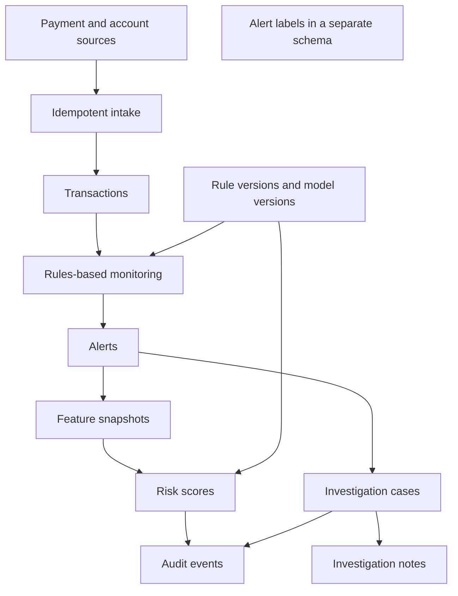

# Solution architecture

## How to read this document

This is the target architecture for AMLOG and a precise statement of what the repository contains today. Components drawn as future steps are design intent. They are not running software.

Terms used here:

| Term | Meaning |
| --- | --- |
| Alert | A monitoring result that asks a person to look at activity. |
| Case | The investigation file for that work. |
| Rule version | One saved definition of a monitoring rule. A published version is not overwritten. |
| Model version | One saved registration of a model. Its identity and training-data provenance are not overwritten. |
| Feature snapshot | The feature values available for one alert at one computation time. |
| Risk score | A number recorded for one alert by one model version, using one feature snapshot. |
| Label | A later judgment used to evaluate alerts or models. It is not a scoring input. |
| Idempotency | Processing the same source event again does not create a second transaction. |
| Provenance | A statement of where data or a model came from, specific enough for a later reviewer to understand it. |

## Current build

| Area | State |
| --- | --- |
| Documentation and schema | Present in this repository. |
| Migration runner and configuration | Present. The runner connects only when a database URL and the `psycopg` driver are configured. |
| Payment intake | A Python ingestion function validates schema 1 and schema 2 payment events, resolves the account from its AMLOG reference or from the source system's account identifier, and stores the transaction. An identical replay does not create a second row. No queue consumer and no AWS integration are built. |
| Monitoring rules | R001 version 1, outgoing transaction velocity, and R002 version 1, rapid funds turnover, can be registered and replayed by in-process functions. Thresholds live in each rule version. No other rule is implemented. No queue consumer and no live monitor are built. |
| Feature calculations | Feature set `alert_behavior` version `1` builds one snapshot per alert from account activity at or before `triggered_at`. Rows are stored in the existing feature tables. |
| Scoring | Two experiment rankings, an Isolation Forest and a robust z-score baseline, can be fit, stored, and reloaded. Their scores are not approved for operational use. A rank is not a probability of financial crime, a productive investigation, or a false positive. Feature deviations are distances from the typical training alert, not causes. |
| Investigation screens | A local page on `127.0.0.1` records a human review and shows the experiment rank beside that review. |
| Local database | PostgreSQL 16 through Docker Compose, listening on `127.0.0.1` only. The development database is separate from the disposable workload database. Neither is a client system. |
| Cloud resources | Not requested and not created. |
| Model algorithm | Isolation Forest for the experiment anomaly rank, with a robust z-score baseline. No supervised false-positive model is approved. |
| Fictional workload | A seeded generator can build customers, accounts, and payment events and load them through ingestion into a disposable database. `rapid_movement` stays cross-account. Same-account shapes include one outgoing payment, several outgoing payments that together reach R002's ratio, and nearby activity that stays below R001 or R002. An episode is emitted only when every payment fits before the history end. Scenario notes stay out of the payment rows and are not an input to a rule. |

The Python package `amlog` exposes settings, migration support, transaction ingestion, a fictional workload loader, the R001 and R002 replays, alert-behavior snapshots, a local investigator review page, and a provisional anomaly ranking. It does not subscribe to an event bus.

## Target logical architecture

Alert labels are intentionally not connected to scoring. A scoring component must not read them. A future database role for scoring should receive rights on the operational schema and no rights on the label schema. That role split is documented and not created here. Creating roles is a deployment choice. The local development database does not define application roles.

## Event processing

The target style is event-driven. Each stage does one job and can be retried. A retry must be safe.

Intended events:

| Event | Meaning | State |
| --- | --- | --- |
| `payment_event_received` | A source delivered a payment event. Schema 1 requires the AMLOG account reference. Schema 2 can use the source system's account identifier. | In-process contract only. No streaming consumer. |
| `transaction_recorded` | Intake stored one new transaction. The ingestion function returns this outcome and writes one audit row in the same database transaction. | Not published to a bus. |
| `alert_created` | Monitoring opened one alert for one active rule version. | The replay writes the alert, its transaction links, and one audit row. No bus event is published. |
| `features_computed` | A feature snapshot was stored for one alert. | The feature command writes the snapshot and one audit row. No bus event is published. |
| `risk_score_recorded` | A model version stored one operational or experiment score. | The prioritize command writes experiment scores for a validated model version. The version is not approved, so an operational score is rejected. No bus event is published. |
| `case_updated` | An investigator changed case status or added a note. | The local review page writes the case change, one note, and one audit row in the same database transaction. No bus event is published. |
| `label_recorded` | A governed labeling step stored an evaluation label. | The same page can append a usefulness assessment. That row is not eligible for model training. No bus event is published. |
| `audit_event_recorded` | A writer stored an audit row for a change. | The audit row for a new transaction is written. No separate bus event is published. |

The idempotency key for payment intake is `(source_system, source_event_id)`. The ingestion function compares a repeated delivery with the stored payment. An identical delivery returns "already recorded" and does not insert again. A repeated identity with different payment details returns a conflict and leaves the stored row unchanged. The database unique constraint remains the backstop if two deliveries race. A second source system may use the same event identifier; that is a different payment. No AWS consumer exists.

Schema 2 resolves `(source_system, source_account_id)` against the unique key already stored on `amlog.accounts`. The customer is copied from that account row. When the event also includes `account_reference`, both identifiers must select that same row. Ingestion does not create missing customers or accounts.

Three clocks are stored on a transaction, all with time zones:

- `event_timestamp`: when the activity happened, according to the source
- `booked_at`: when the source booked it, if the source says so
- `ingested_at`: when this platform stored it

Those clocks support later latency measurement. They are not a latency promise.

## R001 replay

R001 version 1 is registered as a draft and then made active. Its parameter document is `direction` `debit`, `window_seconds` `3600`, and `minimum_count` `6`. Changing a number means a new version. The evaluator does not contain those numbers.

The replay considers a debit only when its `event_timestamp` is inside the rule version's effective window. Version 1 is effective from 1 January 2025 UTC, which is the start of the fictional workload, not a statement that the rule was live in 2025. Credits are not counted. For each debit, the window is the closed interval that ends at that debit and starts 60 minutes earlier. Debits after that instant are not visible.

The first debit whose window contains at least six debits opens one alert. The linked transactions are exactly the debits in that window. The last of them is `triggering`. The earlier ones are `supporting`. `triggered_at` is that debit's event time. The alert summary says the row came from a historical replay.

A later debit on the same account does not open another alert while its own rolling window still meets the threshold. That is the same burst. When a later debit's window falls below the threshold, the burst has ended. The next crossing is a new alert. Because the alert snapshot cannot be rewritten, later debits in the same burst are not added to the original link set.

The alert reference is `R001`, the version, the account id, and the triggering transaction id. A second replay of the same stored history finds that reference and inserts nothing new.

A late debit that is already stored is placed by event time if the account is replayed again from the stored rows. Live monitoring is not built. If an alert was already stored, and a late debit would have made a different transaction the first crossing, the old alert stays. The new reference can insert a second alert. Reconciling those two immutable alerts is an open review point. The workload replay was run once over the finished history, so that case did not arise there.

The replay reads `amlog.transactions` and the rule version. It does not read scenario notes or evaluation labels. It refuses the development database named `amlog`.

## R002 replay

R002 version 1 is a separate rule. Replaying it does not change R001 or the alerts R001 already stored. Its parameter document is `minimum_incoming_amount` `500`, `outgoing_ratio` `0.80`, `window_seconds` `86400`, and `amount_basis` `transaction_currency`. The evaluator does not contain those numbers, and it does not convert currencies.

A credit qualifies only when its own amount is at least the minimum. Smaller credits are not added together. The replay then looks forward only as far as the payment it is judging. An alert opens on the later debit that makes the allocated outgoing amount reach the ratio. It does not open when the credit arrives.

Allocation is oldest-first. An outgoing amount in the same currency is matched to the oldest incoming payment that is still inside its 24-hour window, up to that incoming amount. The matched amount is not matched again. Amount above that incoming payment can be matched to the next one. A different currency is ignored, including when a base amount or an exchange rate is present. After the ratio is reached, one alert is kept for that incoming payment. Further outgoing amount may still be reserved against the remainder of that incoming amount so it cannot fund a second alert, but it is not added to the frozen evidence.

The incoming payment is linked as `contextual`. Outgoing payments allocated before the crossing are `supporting`. The outgoing payment that reaches the ratio is `triggering`. `triggered_at` is that outgoing payment's event time. The summary states that the finding compares amounts and does not prove that the same funds were transferred.

The alert reference is `R002`, the version, the account id, and the incoming transaction id. A second replay of the same history inserts nothing new. The effective time is 1 January 2025 UTC, the same historical-replay boundary used for R001.

## Data architecture

PostgreSQL is the system of record for parties, accounts, transactions, rule versions, alerts, feature snapshots, model versions, scores, cases, notes, labels, and audit events.

Design choices that protect high-volume use without pretending a volume test has been run:

- Transactions are rows in one table, with indexes for account, customer, channel, type, counterparty reference, and event time. There is no configured row cap.
- Features are rows, not columns. Adding a behavior measure does not require a schema change.
- A BRIN index on event time is included because large append-only tables are often read in time order. It is a starting choice, not a measured tuning result.
- Monthly partitioning of transactions and audit events is the planned scale path. It is not in the first migration. PostgreSQL requires the partition column in unique keys and foreign keys, which would complicate alert links. Partitioning should be a deliberate migration after retention and volume are known.
- Counterparties are attributes of the payment event, not a mastered party table. Payment messages often carry incomplete counterparty details. A later entity-resolution design can add a counterparty master without discarding the original event text.

Customer, account, and channel behavior can be computed later from transactions. Those calculations are not in this repository.

## Model governance

No candidate algorithm is included and none is preferred.

A future experiment should compare candidates on four qualities, all measured at alert level:

1. Predictive quality: how well the score ranks alerts that were later judged useful to review, on a disclosed dataset.
2. Explanation capability: whether a reviewer can see which inputs contributed to the score in a form an investigator can read.
3. Inference latency: the time to score one alert under a stated test setup. No target number is set here.
4. Maintainability: whether the team can train, explain, approve, retire, and reproduce the version without undocumented manual steps.

The registry lifecycle is:

`registered` → `validated` → `approved` → `retired`

`registered` or `validated` may also move to `rejected`. Rejected and retired versions stay in the table. They are not deleted.

Only an `approved` version may produce an `operational` score. A `validated` or `approved` version may produce an `experiment` score. This lets a future experiment write scores without presenting an unapproved model as the operational one.

While a version is still `registered`, its artifact reference and evaluation summary may be completed. Name, algorithm family, feature-set identity, and training-data provenance are immutable from the moment of insert. After the version leaves `registered`, the artifact reference and evaluation summary are frozen too. A correction is a new version.

Every version requires a non-empty `training_data_provenance` value. The methodology document says what that statement must contain.

Scores store a copy of the model name, version label, algorithm family, feature-set identity, and input fingerprint. A database trigger rejects a score whose copy does not match the referenced rows. Later edits cannot rewrite a score.

The explanation document is an open JSON object so a later experiment can compare explanation styles. It may be empty. An operational process should not show investigators a score that has no explanation. That process is not built, and the database does not pretend an explanation exists by storing an empty object.

## Security and privacy principles

- The database owner in a future environment is not the scoring user and not the labeling user. Separate roles remain to be created with the database.
- Public privileges are revoked on the two schemas. The creating user still owns them.
- Trigger functions are not executable by `PUBLIC`.
- Secrets do not belong in source files. `AMLOG_DATABASE_URL` is an environment variable. The sample file has an empty value.
- The application does not read `.env` files by itself.
- Customer data minimization is intentional. Adding government identifiers or contact data later requires an access-control and retention decision, not only a new column.
- Encryption in transit and at rest, key management, and network isolation belong to the deployment design below. They are not configured here.
- Deletes of history are rejected inside the database. Dropping a disposable development database remains the reset method.

## AWS deployment target

The deployment target is Amazon Web Services. Nothing in this target has been provisioned.

| Concern | Target service | Status |
| --- | --- | --- |
| System of record | Amazon RDS for PostgreSQL or Aurora PostgreSQL, version 15 or newer | Not created. |
| Event transport | Amazon SQS or Amazon EventBridge. The choice is open. | Not created. |
| Application compute | A container service or function service, chosen with the first runtime component | Not created. |
| Model artifacts | Amazon S3, addressed only by a reference stored on the model version | Not created. |
| Credentials | AWS Secrets Manager | Not created. |
| Encryption keys | AWS KMS | Not created. |
| Logs and metrics | Amazon CloudWatch | Not created. |
| Network | A private VPC, with the database not exposed to the public internet | Not created. |

No infrastructure template is included. A template would be easy to mistake for permission to create resources.

## Configuration

| Setting | Meaning | Foundation default |
| --- | --- | --- |
| `AMLOG_ENVIRONMENT` | `local`, `test`, or `development` | `local` |
| `AMLOG_DATABASE_URL` | PostgreSQL connection string | unset, which means do not connect |
| `AMLOG_LOG_LEVEL` | `DEBUG`, `INFO`, `WARNING`, or `ERROR` | `INFO` |
| `AMLOG_MIGRATIONS_DIR` | Folder of numbered SQL files | `db/migrations` |

`production` is rejected by configuration so this foundation cannot be labeled as a live environment.

## Decisions recorded for review

| ID | Decision |
| --- | --- |
| ADR-001 | Monetary amounts use `NUMERIC(38, 8)`. Exchange rates use `NUMERIC(38, 18)`. Floating point and the locale-dependent currency type are not used. |
| ADR-002 | All instants use `TIMESTAMPTZ`. |
| ADR-003 | Duplicate protection is the unique pair `(source_system, source_event_id)`. |
| ADR-004 | Features are stored one value per row. There is no feature-count limit and no wide feature table. |
| ADR-005 | Published rule versions and model identity are immutable. New behavior is a new row. |
| ADR-006 | Each score stores the model and feature snapshot it used. The database checks that copy and rejects a score whose feature-set name or version differs from the feature set required by the model version. |
| ADR-007 | Evaluation labels live in schema `amlog_label`. Scoring tables do not reference them. |
| ADR-008 | No algorithm is selected. Experiments are judged later by alert-level predictive quality, explanation capability, inference latency, and maintainability. Superseded for the experiment rank by ADR-024. |
| ADR-009 | Time partitioning is documented and deferred. |
| ADR-010 | Counterparties remain attributes of the transaction event. |
| ADR-011 | An account has one current customer, and that customer link is immutable. |
| ADR-012 | No cloud resource and no database server is installed by this foundation. |
| ADR-013 | Transactions, features, scores, notes, labels, audit events, and applied migration rows are append-only. |
| ADR-014 | A productive label means the alert was useful to review. It is not a legal finding. |
| ADR-015 | Intake accepts `payment_event_received` schema 1 and schema 2. The customer is copied from the account row. The event cannot supply a customer, a label, or a score. Identical replays are acknowledged. Changed replays conflict and are not stored. |
| ADR-016 | Schema 2 may identify an account by `(source_system, source_account_id)`. Schema 1 is unchanged. If both the canonical reference and the source account id are present, they must name one account or the event is rejected. |
| ADR-017 | Fictional workloads are loaded only into a disposable database. Scenario notes live in schema `amlog_scenario` and are not columns on transactions. They are not fraud judgments or model labels. |
| ADR-018 | R001 version 1 stores `direction`, `window_seconds`, and `minimum_count` in `parameter_document`. The replay counts matching transactions in the closed event-time interval that ends at the transaction being judged. It opens one alert when the count first reaches the threshold and suppresses further alerts while that rolling count stays at or above the threshold. The alert reference is the rule version, the account, and the triggering transaction. Scenario notes and labels are not inputs. The development database is refused. This replay is not live monitoring. |
| ADR-019 | R002 version 1 stores the incoming minimum, the outgoing ratio, the window, and `amount_basis` `transaction_currency`. Outgoing amount is allocated oldest-first to an earlier same-currency incoming payment, once, and only up to that incoming amount. The alert opens on the outgoing payment that reaches the ratio. The incoming payment is context, not proof that the same funds moved. R001 alerts are left unchanged. |
| ADR-020 | `rapid_movement` remains a receipt and a later payment on two different accounts. Same-account receipt and payment shapes are separate scenario codes. They vary amount, timing, currency, customer type, and counterparty. They are not fraud labels, and R002 is not changed to create alerts. |
| ADR-021 | An integrated workload may contain R001 bursts and R002 episodes in one history. A multi-payment episode starts only when every leg fits in the remaining quota and at or before the history end. `same_account_split` reaches the R002 ratio across several outgoing payments. `same_account_partial`, `velocity_short`, and `velocity_wide` stay outside the current thresholds. A payment that would otherwise sit one second after an earlier payment is moved two hours later when the history allows. R001 and R002 definitions are unchanged, and neither rule reads scenario notes. |
| ADR-022 | The prediction unit is one alert. Feature set `alert_behavior` version `1` uses only the alert's account and payments whose event time is at or before `triggered_at`, inside a 30-day lookback. Amounts are aggregated in the account currency only. Undefined amount statistics and ratios are omitted rather than stored as zero. A matching input fingerprint is not written twice. A different fingerprint is a new snapshot. Labels, scenario notes, and case outcomes are not inputs. The experiment ranking chosen in ADR-024 is separate from this feature-set decision. |
| ADR-023 | A local page on `127.0.0.1` lets a reviewer open one case for one alert, append notes, append a usefulness assessment, close with an operational disposition, and reopen. Usefulness is stored as `productive_alert`, `non_productive_alert`, or `uncertain`, with source `investigator_outcome`, origin `operational`, and `eligible_for_evaluation` false. A judgment entered in this review is a current review record. It is not a historical import, it is not a crime finding, and it is not a training label. The operational disposition stays one of the four case values and is not copied into the label. Earlier notes, labels, and the previous disposition in the audit row are kept. An identical current assessment is rejected. Existing alerts are not labeled automatically. There is no user table. The reviewer reference is entered on the form, and localhost binding is not authentication. |
| ADR-024 | Provisional priority is an Isolation Forest anomaly rank plus a robust z-score baseline. Both are experiment scores from model versions that are validated for experiment scoring and not approved. A higher score means more unusual relative to the training alerts. It is not a probability of financial crime, a productive investigation, or a false positive. The fit uses `alert_behavior` version 1, excludes rule codes, labels, dispositions, scenario notes, and identifiers, scales amounts inside one currency on the training accounts only, and imputes missing values from those accounts only. One account is entirely in the fit or entirely in the holdout. The fitted trees and preprocessing parameters are written to a local artifact file named by the parameter digest. Reloading that file scores the same snapshots without fitting again and without editing the validated model row. A feature deviation is a robust z-score distance from the typical training value. It is not a cause of the rank or of the alert. Supervised training is blocked until enough eligible reviewed productive and non-productive outcomes exist from at least two reviewers. That blocked path does not invent labels or report precision, recall, or ROC-AUC. |

## Points for architectural review

1. Is one current customer per account acceptable until an ownership-history design is reviewed?
2. Should counterparty mastering be designed before feature engineering, or after real event samples exist?
3. Should a registered model version be editable until validation, beyond the artifact reference and evaluation summary?
4. Should an operational score be rejected unless an explanation document is present, once the explanation shape is agreed?
5. The in-process intake function is in place. Should the first deployed consumer be a queue, an event bus, or a batch file, and is that choice needed before any further intake work?
6. Should intake reject a payment for a closed or restricted account, or store it because a late event can still be real?
7. Should a source-supplied base amount be checked against the amount and exchange rate, or stored exactly as received?
8. Correction events are not accepted yet. When they are added, should the event cite the earlier source event instead of the internal transaction identifier?
9. Are the closed-case outcomes `no_further_action`, `continue_monitoring`, `escalated`, and `inconclusive` the right operational vocabulary?
10. Schema 2 uses the payment's source system as the account's source system. Should a later version carry a separate account-system identifier when the payment rail and the account master are different systems?
11. Should a future evaluation set be drawn from several seeded populations, and should scenario notes ever be copied into the label schema by a reviewed process?
12. When a late debit would have changed which transaction first crossed the R001 threshold, should a later replay keep both immutable alerts or suppress the new reference because the bursts overlap? Live reconciliation is not built.
13. Should a later R002 version allocate an outgoing payment across all open incoming payments in proportion, instead of oldest-first? Version 1 uses oldest-first so the allocation is deterministic and the same outgoing amount is not used twice.
